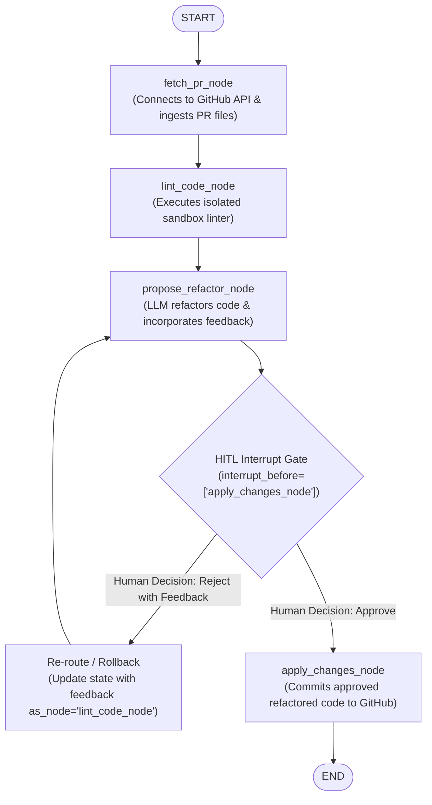

# RookieStuff: Autonomous Code Review & Refactoring Agent with LangGraph

- **Repository**: [https://github.com/sayan-kundu000/RookieStuff](https://github.com/sayan-kundu000/RookieStuff)
- **Project Name**: RookieStuff
- **Core Stack**: Python 3.11+, LangGraph, LangChain, GitHub API, FastAPI, Flake8/Black, Docker, Pytest

---

## 1. Project Overview & Business Context

**RookieStuff** is an enterprise-grade autonomous code review and refactoring agent built on **LangGraph**. It automates the software engineering lifecycle for incoming Pull Requests (PRs):
1. **Pulls modified files** from incoming PRs via the GitHub API.
2. **Executes code analysis and linters** inside an isolated execution sandbox using custom LangChain tools (`flake8`, `black --check`, and AST syntax validation).
3. **Proposes refactored code** utilizing LLMs to fix styling, syntax, and maintainability issues while preserving original functional logic.
4. **Halts execution before pushing changes** using a Human-in-the-Loop (HITL) interrupt gate (`interrupt_before=["apply_changes_node"]`).
5. **Supports human review feedback loops**: if a reviewer submits changes or rejections, the agent writes feedback to the persistent checkpointer state, rolls back the thread, and re-routes back to regenerate the refactoring proposal.
6. **Commits approved changes** directly back to the repository branch upon explicit human confirmation.

---

## 2. Architecture & LangGraph State Machine



### Review State Schema
The LangGraph pipeline maintains state across thread executions using persistent checkpointers (`MemorySaver` or `SqliteSaver`):
- `pr_url` (*str*): The target GitHub Pull Request URL.
- `code_contents` (*str*): The raw code extracted from the PR.
- `lint_errors` (*str*): Standard error/stdout diagnostics from sandboxed linters.
- `refactored_code` (*str*): Proposed clean code generated by the agent.
- `is_approved` (*bool*): Human engineer validation status.
- `reviewer_feedback` (*Optional[str]*): Contextual notes or revision requests from the human reviewer.
- `history` (*list*): Append-only audit trail capturing all node executions, timestamped decisions, and diffs.

---

## 3. Installation & Setup

### Prerequisites
- Python 3.11+
- Git
- Docker (optional for containerized deployment)

### 1. Configure `.env` file
Copy the environment template and populate your API credentials:
```bash
cp .env.example .env
```

Edit `.env`:
```env
GITHUB_TOKEN=ghp_yourPersonalAccessTokenHere
OPENAI_API_KEY=sk-yourOpenAiApiKeyHere
OPENAI_MODEL=gpt-4o-mini
HOST=0.0.0.0
PORT=3000
ENVIRONMENT=development
CHECKPOINTER_TYPE=memory
```
*(Note: If no API keys are supplied, RookieStuff automatically operates in mock fallback mode with simulated commits and deterministic rule-based refactoring for tests and offline development).*

### 2. Install Dependencies
```bash
pip install -r requirements.txt
```

### 3. Run FastAPI Web Server
```bash
uvicorn main:app --reload
```
The server will start at `http://localhost:3000`. Interactive OpenAPI documentation and Dashboard are available at:
- **Interactive Review Dashboard**: `http://localhost:3000` or `http://localhost:3000/dashboard`
- **Swagger UI**: `http://localhost:3000/docs`
- **ReDoc**: `http://localhost:3000/redoc`
- **OpenAPI JSON**: `http://localhost:3000/openapi.json`
- **Health Check**: `http://localhost:3000/health`

### 4. Run Automated Tests
```bash
pytest
```

---

## 4. Verification & Validation Workflows

The system satisfies all 3 required evaluation test workflows:

### Test Case 1: Webhook PR Ingestion, Linting, & HITL Pause Gate
Simulate an incoming GitHub PR webhook:
```bash
curl -X POST "http://localhost:3000/api/webhooks/github" \
     -H "Content-Type: application/json" \
     -d '{
       "repository_url": "https://github.com/octocat/Hello-World",
       "branch": "feature/pricing-fix",
       "pr_url": "https://github.com/octocat/Hello-World/pull/42",
       "code_contents": "def calculate_total_price(items, tax_rate):\n    total = 0\n    for item in items:\n      total = total + item[\"price\"]\n    tax=total*tax_rate\n    return total+tax\n"
     }'
```
**Expected Response:** Status `201 Created`. The agent creates a new thread, executes `fetch_pr_node`, `lint_code_node`, `propose_refactor_node`, and halts at `interrupt_before=["apply_changes_node"]` with `next_nodes: ["apply_changes_node"]`.

### Test Case 2: Feedback Input & Refactoring Proposal Re-route Loop
Submit a review rejection with revision guidance:
```bash
curl -X POST "http://localhost:3000/api/reviews/{thread_id}/approve" \
     -H "Content-Type: application/json" \
     -d '{
       "approved": false,
       "feedback": "Use list comprehensions instead of loops"
     }'
```
**Expected Response:** Status `200 OK`. The agent updates the checkpointer state with the feedback, re-routes back to `propose_refactor_node`, updates the refactored code using list comprehensions, and pauses again at the write gate (`next_nodes: ["apply_changes_node"]`).

### Test Case 3: Approval and Git Commit Write Back
Submit human approval:
```bash
curl -X POST "http://localhost:3000/api/reviews/{thread_id}/approve" \
     -H "Content-Type: application/json" \
     -d '{
       "approved": true,
       "feedback": "LGTM"
     }'
```
**Expected Response:** Status `200 OK`. The agent resumes execution into `apply_changes_node`, commits the refactored code to the repository branch, returns a commit SHA, and terminates at `END` with `next_nodes: []`.

---

## 5. API Reference & Endpoints

| Method | Endpoint | Description |
|---|---|---|
| `POST` | `/api/webhooks/github` | Ingests PR webhooks, spawns LangGraph thread, executes to HITL pause gate. |
| `POST` | `/api/reviews/{thread_id}/approve` | Submits approval (`true`/`false`) and optional reviewer feedback. |
| `GET` | `/api/reviews/{thread_id}` | Inspects review thread state, diagnostics, and full audit history. |
| `GET` | `/health` | Service health check and checkpointer status. |
| `GET` | `/` | Service metadata and entrypoints directory. |

---

## 6. Docker Containerization

### Run with Docker Compose
```bash
docker-compose up --build
```

### Run with Docker CLI
```bash
docker build -t rookiestuff:latest .
docker run -p 3000:3000 --env-file .env rookiestuff:latest
```

---

## 7. Workspace Layout

```
RookieStuff/
├── app/
│   ├── __init__.py           # Application package & metadata
│   ├── config.py             # Settings via pydantic-settings (.env)
│   ├── state.py              # LangGraph ReviewState schema & history model
│   ├── tools/
│   │   ├── __init__.py       # Tools registry
│   │   ├── sandbox.py        # @tool run_linter_tool (flake8, black, syntax)
│   │   └── github_client.py  # GitHub API client (PR ingest & commit writeback)
│   ├── graph/
│   │   ├── __init__.py       # Graph package
│   │   ├── nodes.py          # fetch_pr, lint_code, propose_refactor, apply_changes
│   │   └── workflow.py       # StateGraph, MemorySaver/SqliteSaver, HITL gate & re-route
│   ├── api/
│   │   ├── __init__.py       # API router package
│   │   ├── schemas.py        # Pydantic request/response schemas
│   │   └── routes.py         # Webhook & Review approval endpoints
│   └── main.py               # FastAPI application factory
├── tests/
│   ├── __init__.py
│   ├── conftest.py           # Pytest fixtures (TestClient, isolated graph)
│   ├── test_sandbox_tool.py  # Syntax isolation & lint test suite
│   ├── test_graph_routing.py # HITL interrupt gate & rollback assertions
│   └── test_api_endpoints.py # End-to-end FastAPI endpoint test cases
├── Dockerfile                # Production container specification
├── docker-compose.yml        # Multi-container orchestration
├── requirements.txt          # Python package dependencies
├── pyproject.toml            # Project metadata & pytest configuration
├── openapi.json              # Exported OpenAPI 3.1 specification (JSON)
├── openapi.yaml              # Exported OpenAPI 3.1 specification (YAML)
├── .env.example              # Environment variables template
├── .gitignore                # Git exclusions
├── main.py                   # Root entrypoint (`uvicorn main:app --reload`)
└── README.md                 # Complete project documentation
```

---

## 8. Git Commit History

The repository demonstrates disciplined developmental progress across 9 distinct stages:
1. `chore: scaffold RookieStuff repository, configs, and dependencies`
2. `feat(config): add settings management with pydantic-settings`
3. `feat(sandbox): implement sandboxed linter tool with flake8 and black analysis`
4. `feat(github): implement GitHub client for PR retrieval and commit writeback`
5. `feat(state): define LangGraph ReviewState schema and audit history models`
6. `feat(graph): construct LangGraph state machine with HITL interrupt gate and feedback re-route`
7. `feat(api): implement FastAPI webhooks and human review approval endpoints`
8. `test(pipeline): add comprehensive automated tests for sandbox, graph rollback, and API`
9. `docs(deploy): add Docker configs, OpenAPI specification, and detailed README`

